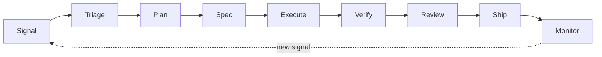

# The MIA software factory

A software factory is the system that turns a signal — a bug report, a review comment, a failing check, a user request — into verified, shipped software. MIA already provides the workflow and state boundary for that system. This page explains how the pieces fit together and what MIA does and does not own.

## What MIA owns, and what the host owns

MIA is the engineering contract and state layer around an agent, not another agent harness. The boundary is deliberate:

| Concern | Owner |
|---|---|
| Model loop, tool routing, sandbox and session lifecycle | Agent host (for example Codex or Claude Code) |
| Skill registry, capability admission, Work lifecycle | MIA |
| Verification contracts and recorded evidence | MIA |
| Signals, prioritisation, and scheduling across surfaces | Host and team process, recorded through MIA state |

The factory is the discipline that connects these. MIA supplies the explicit contracts; the host supplies the execution.

## From signal to production

Work moves through named phases. The factory `map` command prints the current list from the executable source.



Not every change runs every phase. A one-line fix can go straight from triage to execute and verify. The phases exist so that a hard change has somewhere explicit to be clarified, specified, and checked.

The phases map onto existing MIA skills and the coordination stages in [.agents/PROTOCOL.md](../../.agents/PROTOCOL.md):

| Phase | MIA skill or stage |
|---|---|
| Signal | issue, pull request, or alert recorded through the host |
| Triage | triage step in the protocol |
| Plan | `mia plan create` |
| Spec | `mia spec` |
| Execute | the host's coding agent, bounded by the Work item |
| Verify | `mia health`, `mia review` |
| Review | `mia review`, Sentry stage |
| Ship | `mia ship` gate |
| Monitor | `mia learn`, `mia retro`, meta loop |

## The three loops

Automation sits at three points, and each point has a different cost budget. Running expensive checks on every iteration wastes time; running only cheap checks lets bad changes through.

| Loop | Runs when | Cost budget | Improves |
|---|---|---|---|
| Inner | while an agent works, before a pull request is opened | cheap and fast, safe to repeat | autonomy |
| Outer | when a pull request is opened | expensive checks, wasteful per iteration | automation |
| Meta | outside development, over logs, pull requests, issues, and feedback | scheduled review | the inner and outer loops |

In MIA terms, the inner loop is the focused test and `mia health` subset the agent runs while editing. The outer loop is the full repository gate that `mia review` and `mia ship` run. The meta loop is `mia retro`, `mia learn`, and the maintainer stage, which turn repeated failures into tests, checks, and focused documentation.

Autonomy and automation are different goals. Autonomy is how often an agent gets a task right without a human correction. Automation is how much work can proceed without human review. Improve autonomy first, then automation, and hold quality constant while doing so.

## Model routing

The factory should choose the cheapest model predicted to clear the quality bar for a task, then escalate when a task fails. MIA exposes this as a deterministic, inspectable rule set:

```bash
mia factory route --complexity high --reasoning
```

The rule set has three tiers. High-risk work and reasoning-heavy work route to the frontier tier; low-complexity work routes to the fast tier and escalates on failure; everything else routes to the balanced tier. The decision names its rationale and a fallback tier so a reviewer can see why a task used a given tier. See [Factory metrics](../reference/factory-metrics.md) for how routing choices are judged by outcome, not by model prestige.

## Surfaces and the control plane

A factory should be surface-agnostic: the same workflow should be reachable from the command line, from a pull request, and from a chat surface. MIA's control plane is small and local:

- the skill registry in `core/skills/index.ts` defines the available commands;
- `mia setup` installs the agent-facing skills for supported hosts;
- Git and the pull request provide the review surface;
- the Work lifecycle and `UnifiedStore` hold durable state.

MIA does not ship a hosted control plane or a sandbox service. Those belong to the host. When a team needs a scheduled or event-driven entry point, it wires the host's automation to the MIA command rather than adding a second runtime to MIA.

## Human control

Humans set architecture, strategy, priority, and risk limits. MIA makes those decisions visible rather than automatic:

- `mia ship` refuses to ship when verification or required approval is missing;
- Work items carry `requiresHumanApproval` and an explicit approval record;
- the coordination protocol keeps review, verification, repository-health, and coordination authority separate, and no agent approves its own work.

Automation should make a consequential decision easier to inspect, not make it disappear.

## Assess before you automate

Before handing more work to agents, measure how ready the codebase is. The `factory` skill reports readiness, metrics, and routing without writing any state:

```bash
mia factory readiness
mia factory metrics
mia factory route --complexity medium
mia factory map
```

Read [Agent readiness](../reference/agent-readiness.md) for the eight areas the readiness command checks, and [Factory metrics](../reference/factory-metrics.md) for the outcome measures it reports.

## Honest current state

The `factory` skill is read-only and deterministic. It assesses the current repository, reports metrics from local state, and routes a task profile. It does not start agents, open pull requests, or deploy software — those remain the host's job. Treat this page as the map of the factory and the commands as the instruments; the automation itself is the host plus the process a team builds around it.

## Related

- [Agent readiness](../reference/agent-readiness.md)
- [Factory metrics](../reference/factory-metrics.md)
- [Running the factory](../workflows/software-factory.md)
- [Architecture](architecture.md)
- [Agent Engineering](agent-engineering.md)
